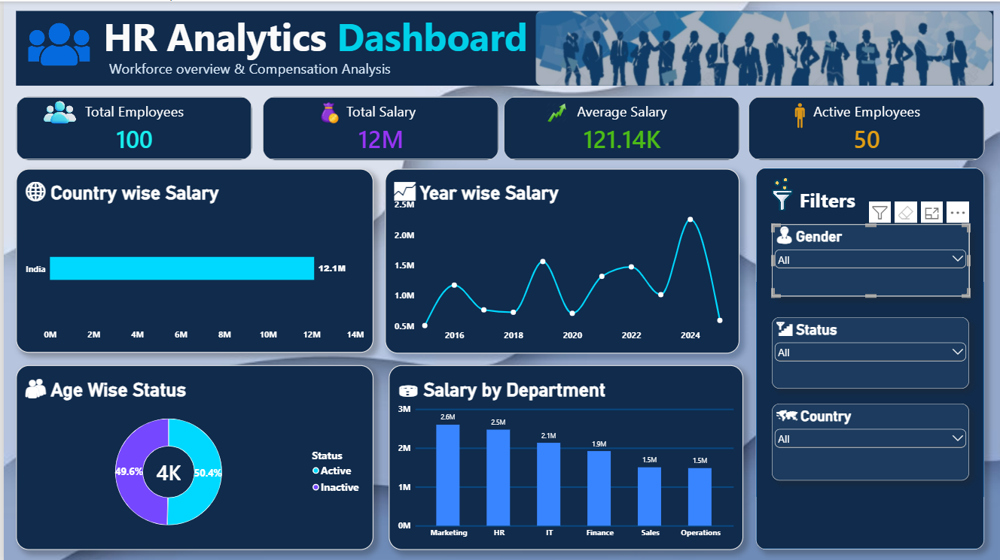

# HR Analytics Dashboard | Power BI

## Project Overview

An interactive HR Analytics Dashboard developed using Microsoft Power BI to analyse workforce distribution, employee demographics, salary expenditure and departmental compensation.

The objective of this project is to transform raw HR data into meaningful business insights and provide management with a consolidated view of workforce metrics.



## Dataset Overview

- **Dataset:** HR Sample Dataset
- **Total Records:** 100 Employees
- **Total Columns:** 12
- **Country:** India
- **Departments:** 6

The dataset includes employee information such as Employee ID, Department, Job Title, Date of Joining, Salary, Gender, Age, City, Country and Employment Status.

## Key Performance Indicators (KPIs)

| KPI | Result |
|---|---:|
| Total Employees | 100 |
| Total Salary | 12,114,236 |
| Average Salary | 121,142.36 |
| Active Employees | 50 |
| Inactive Employees | 50 |

## Analysis & Business Insights

### 1. Workforce Analysis
- Analysed a workforce of 100 employees.
- Identified 50 active and 50 inactive employees.
- Examined employee distribution by gender and employment status.
- Found that female employees represent 57% of the workforce and male employees represent 43%.

### 2. Department-wise Salary Analysis

Compared total salary expenditure across six departments.

| Department | Total Salary |
|---|---:|
| Marketing | 2,600,437 |
| HR | 2,473,110 |
| IT | 2,134,082 |
| Finance | 1,921,189 |
| Sales | 1,503,133 |
| Operations | 1,482,285 |

**Key Insight:** Marketing has the highest total salary expenditure, followed by HR and IT. Operations has the lowest salary expenditure among the six departments.

### 3. Year-wise Salary Analysis

Analysed salary distribution based on employee joining years.

**Key Insight:** Employees who joined in 2024 account for the highest total salary allocation, approximately 2.26 million.

This analysis helps compare salary allocation across different employee joining cohorts.

### 4. Country-wise Salary Analysis

- Analysed salary distribution by country.
- India accounts for the entire dataset's salary expenditure.
- The analysis provides a country-level view of compensation.

### 5. Employee Status Analysis

- Compared active and inactive employees.
- Active employees: 50%
- Inactive employees: 50%

**Key Insight:** The dataset shows an equal distribution between active and inactive employees, providing a useful starting point for workforce status analysis.

## Dashboard Features

- Interactive KPI cards.
- Country-wise salary bar chart.
- Department-wise salary column chart.
- Year-wise salary trend line chart.
- Employee status donut chart.
- Dynamic slicers for Gender, Status and Country.
- Interactive filtering across dashboard visuals.

## Tools & Technologies

- Microsoft Power BI Desktop
- Microsoft Excel
- DAX (Data Analysis Expressions)
- Data Visualization
- Data Analysis

## DAX Measures

**Total Employees**
```dax
Total Employees =
DISTINCTCOUNT(HR_Sample_Dataset[EmployeeID])
```

**Total Salary**
```dax
Total Salary =
SUM(HR_Sample_Dataset[Salary])
```

**Average Salary**
```dax
Average Salary =
AVERAGE(HR_Sample_Dataset[Salary])
```

**Active Employees**
```dax
Active Employees =
CALCULATE(
    DISTINCTCOUNT(HR_Sample_Dataset[EmployeeID]),
    HR_Sample_Dataset[Status] = "Active"
)
```

## Business Value

This dashboard helps HR teams and management:

- Monitor workforce composition and employee status.
- Understand salary allocation across departments.
- Compare salary distribution across joining years.
- Explore employee demographics using interactive filters.
- Support workforce reporting and compensation planning.

## Project Limitations

- The dataset contains records from only one country, limiting geographical comparisons.
- The analysis is based on 100 sample employee records.
- Salary by joining year represents salary grouped by joining year, not historical salary growth.
- The dataset does not provide enough information to establish the reasons behind employee inactivity.

## Author

**Muzammil**  
Aspiring Data Analyst

Skills: Excel | SQL | Power BI | Python

LinkedIn: https://www.linkedin.com/in/mdmuzammil1208

GitHub: https://github.com/mdmuzzammil2003
